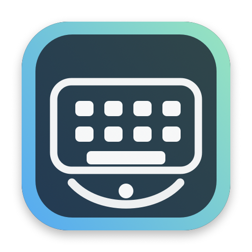
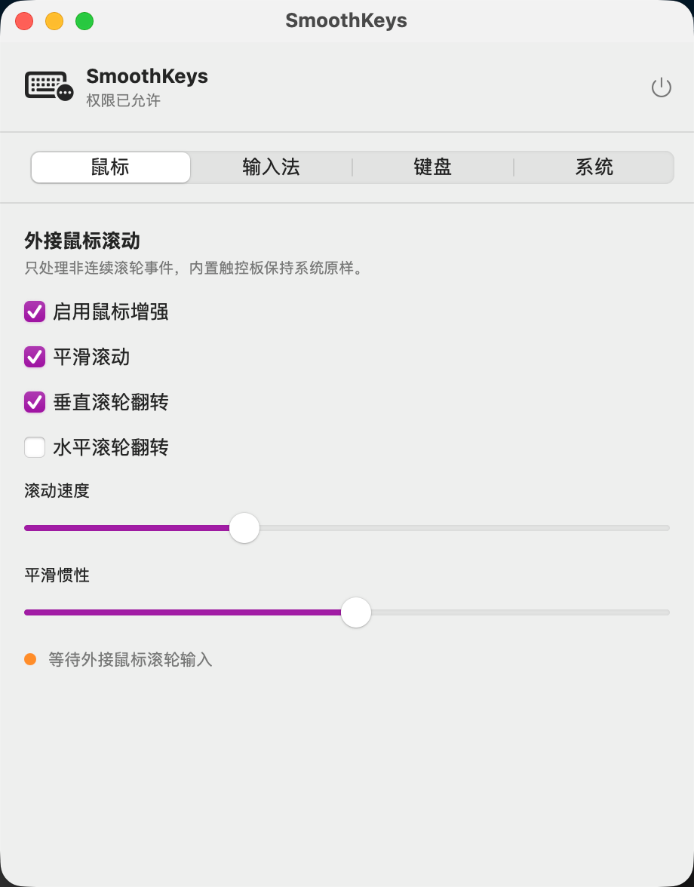
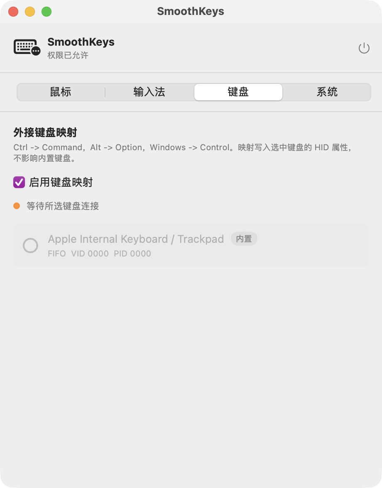
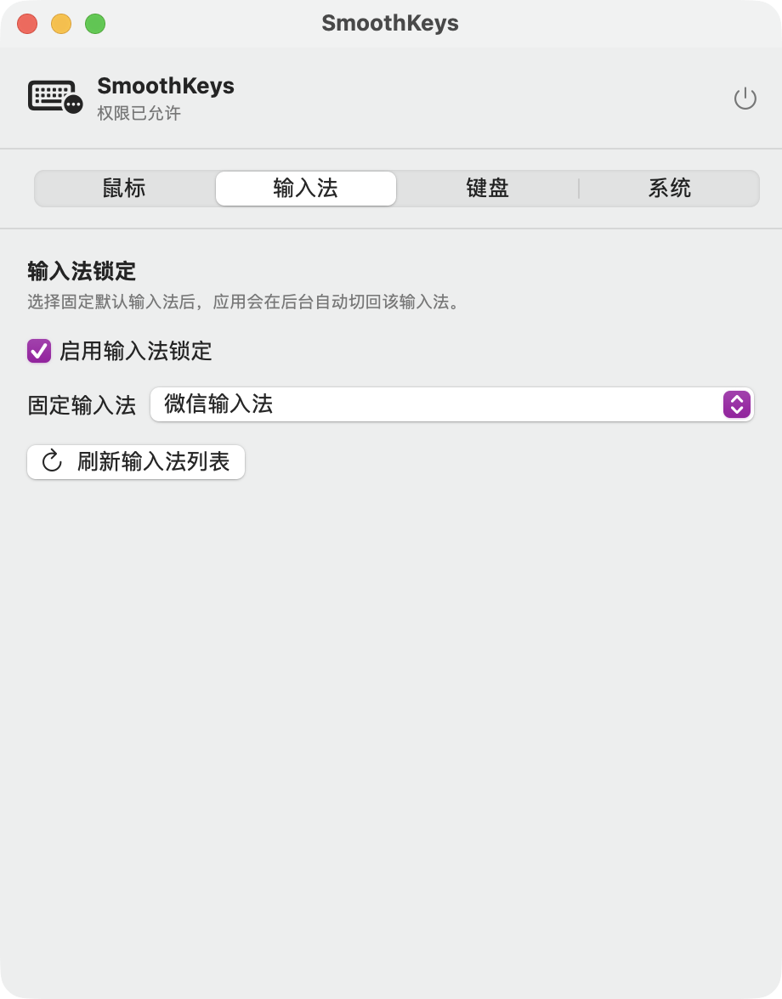
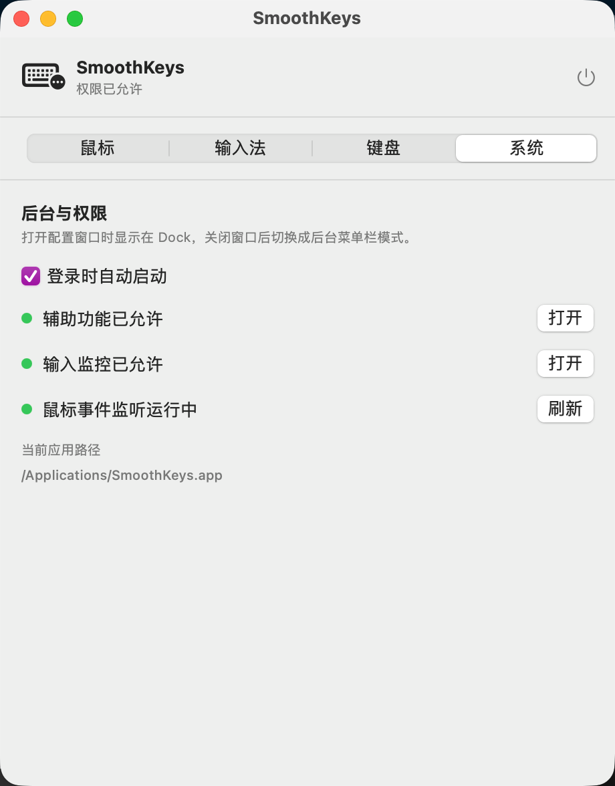
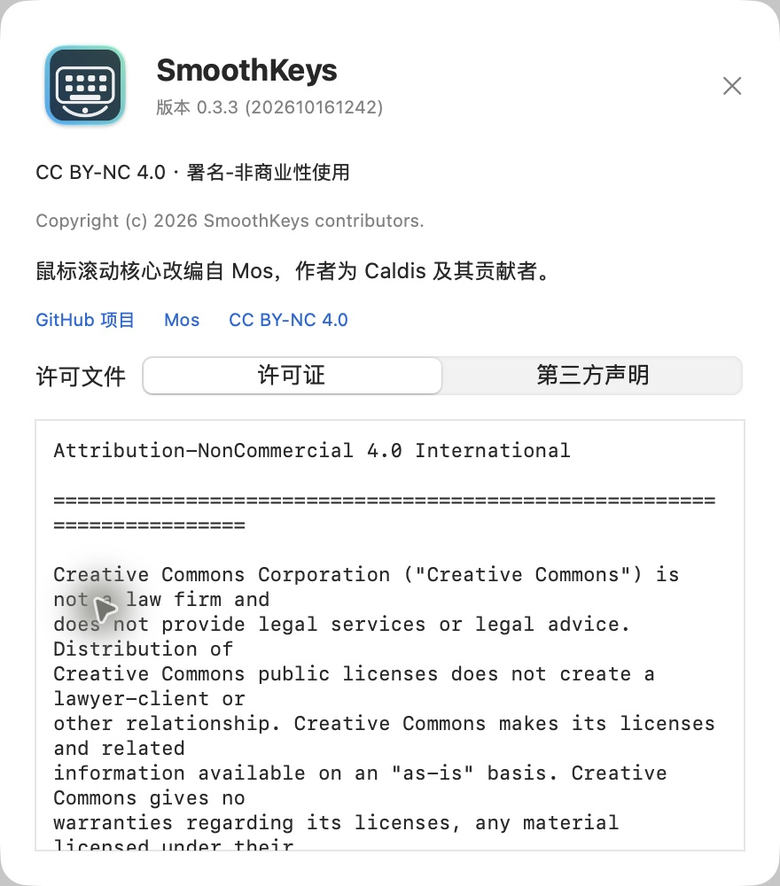
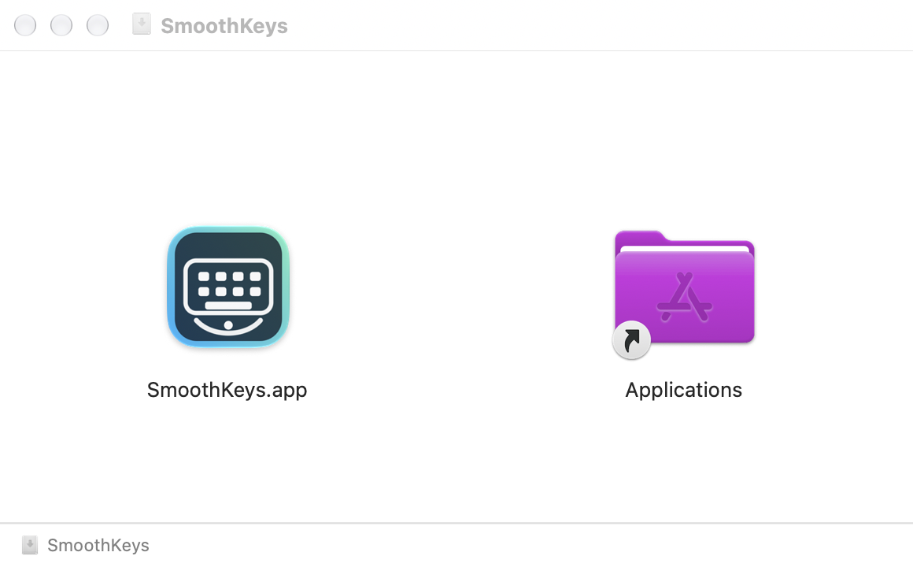

<p align="center">
  
</p>

<h1 align="center">SmoothKeys</h1>

<p align="center">外接鼠标平滑与翻转 · 外接键盘映射 · 固定输入法</p>

SmoothKeys 是一个轻量的 macOS 菜单栏工具，把三个日常功能放在同一个应用中，减少后台工具、权限和更新的管理成本。

当前版本 **0.3.3**，由个人日常使用版本整理而来，功能和设备兼容性仍在完善中。

[下载 App](https://github.com/outsider114/SmoothKeys/releases/latest)

## 外接鼠标

解决普通鼠标在 Mac 上滚动方向不习惯、滚轮不够平滑，以及调整系统滚动设置时影响触控板方向的问题。

- 平滑滚动，可调整速度与惯性。
- 垂直、水平滚轮分别翻转。
- 内置触控板保持系统原有滚动行为。
- 显示滚轮处理状态，检测到 Mos 运行时自动暂停鼠标增强。
- 设置页提供 Mos 致谢与项目链接。



鼠标滚动核心改编自 [Mos](https://github.com/Caldis/Mos)。需要更完整的鼠标滚动设置，推荐使用 [Mos](https://github.com/Caldis/Mos)。

## 外接键盘

面向 Windows 与 Mac 双持用户：在 MacBook 上使用原有键位，接上普通 PC 键盘后，则让常用快捷键沿用熟悉的 Windows 按键习惯。

选择需要映射的外接键盘后，应用以下修饰键映射：

| 外接键盘按键 | 映射为 |
| --- | --- |
| Ctrl | Command |
| Alt | Option |
| Windows | Control |

例如，外接键盘上的 Ctrl+C、Ctrl+V、Ctrl+Z 可以对应 Mac 的复制、粘贴和撤销。映射只作用于所选外接键盘，不影响内置键盘；左右修饰键均支持。



当前所选键盘共用这套预设。需要更多自定义规则，可以使用 [Karabiner-Elements](https://github.com/pqrs-org/Karabiner-Elements)。

## 固定输入法

选定一个输入法后，后台自动保持该系统输入源。输入法自身的中英文切换不受影响。

许多第三方输入法已能在同一个输入源中完成中英文输入，因此 SmoothKeys 目前只提供全局固定功能。需要按应用、网址等规则切换，推荐使用 [KeyboardHolder](https://github.com/leaves615/KeyboardHolder)。



## 菜单栏与后台

- 菜单栏常驻，点击图标打开配置窗口。
- 打开窗口时显示 Dock 图标，关闭后转为后台菜单栏模式。
- 支持登录时自动启动。
- 在“系统”页查看权限状态和当前应用位置。
- 在“关于与许可”中查看版本、许可证与第三方署名。



“系统”页的“关于与许可”提供版本信息、项目链接，以及可离线查看的许可证和第三方声明。



## 安装与权限

1. 从 [Releases](https://github.com/outsider114/SmoothKeys/releases/latest) 下载 Apple Silicon 版 `.dmg`，打开后将 `SmoothKeys.app` 拖入“应用程序”，再从“应用程序”启动。不要直接在磁盘映像中运行。
2. 在“系统”页按提示授予辅助功能、输入监控权限。
3. 按需开启鼠标增强、选择外接键盘和固定输入法。
4. 需要开机运行时，开启“登录时自动启动”。



若授权后仍未生效，请确认授权的是当前安装位置的应用，并重新启动。更换签名或使用其他位置的副本时，可能需要重新授权。

App 使用临时签名，尚未经过 Apple 公证；首次运行需按 macOS 提示允许打开。

## 从源码构建

需要 macOS 13 及以上，以及 Xcode Command Line Tools 或 Xcode：

```bash
bash scripts/build_app.sh
```

产物位于 `outputs/SmoothKeys.app`，默认构建当前主机架构。可通过 `SMOOTHKEYS_SIGN_IDENTITY` 指定本机签名身份；未指定时，脚本优先使用本机 Apple Development 身份，否则使用临时签名。

在 macOS 桌面会话中制作 DMG：

```bash
bash scripts/build_dmg.sh
```

DMG 和 `SHA256SUMS` 位于 `outputs/releases/v<版本号>/`。打包脚本只对分发副本使用临时签名，不改变本机安装版的签名。

运行基本自检：

```bash
outputs/SmoothKeys.app/Contents/MacOS/SmoothKeys --self-test
```

滚动自检需要已登录的 macOS 桌面会话，不替代真实设备测试。参与开发见 [CONTRIBUTING.md](CONTRIBUTING.md)，安全问题请按 [SECURITY.md](SECURITY.md) 私下反馈。

## 使用说明

- 不建议同时使用多个工具处理同一滚轮或键盘。
- 键盘映射会替换所选设备当前的 HID 映射；关闭映射或正常退出时清空该映射，不会还原其他工具预先写入的规则。
- Magic Mouse、特殊鼠标驱动，以及标识不完整的同型号键盘可能存在兼容性差异；更换 USB 端口后可能需要重新选择键盘。
- 当前保留的应用产物为 Apple Silicon 版本；其他系统与架构的兼容性仍需验证。
- 设置和少量滚轮诊断日志保存在本机，不记录键盘输入内容。当前没有联网更新或遥测。

反馈问题时，请附系统版本、设备型号、连接方式和复现步骤，并对日志、截图中的个人信息做脱敏处理。

## 后续更新

- macOS 键位预设。
- 自定义键位映射，每把键盘独立配置，包括内置键盘。
- 自动更新。

## 许可与致谢

[CC BY-NC 4.0](LICENSE)。允许在许可条件下非商业使用、修改和分发。

感谢 [Mos](https://github.com/Caldis/Mos) 的鼠标滚动实现。上游署名及修改说明见 [第三方声明](THIRD_PARTY_NOTICES.md)。
